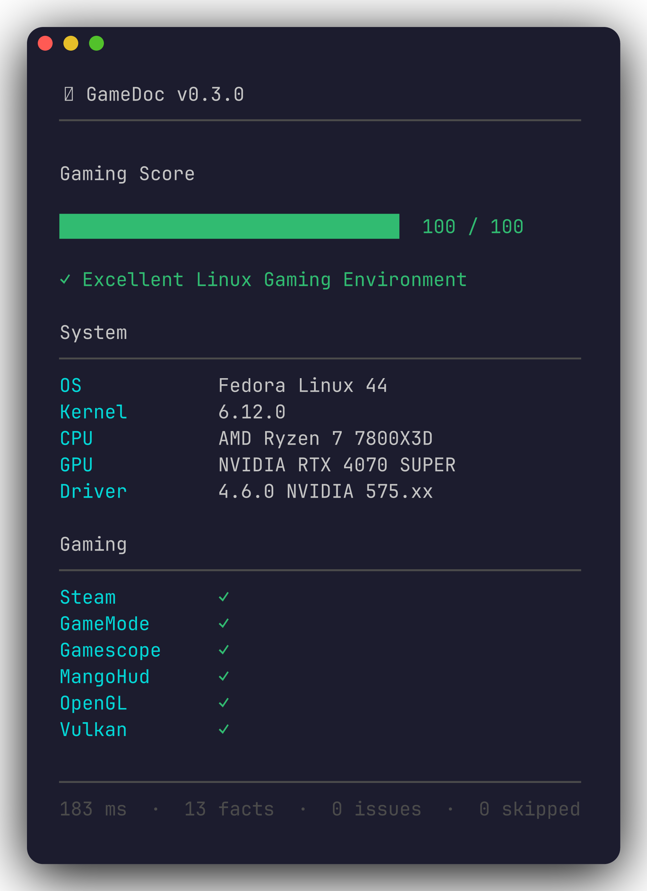

# GameDoc

[](https://crates.io/crates/gamedoc)
[](https://docs.rs/gamedoc)
[](https://opensource.org/licenses/MIT)

**Deterministic, read-only Linux gaming diagnostics.**

GameDoc audits your Linux gaming stack and produces a scored, structured
report. Use it to diagnose issues, share with support channels, or verify
your setup before a gaming session.



---

## What GameDoc does

- Scores your gaming environment out of 100
- Detects missing or broken dependencies (Vulkan, Proton, Steam, MangoHud, GameMode, Gamescope)
- Reports CPU, GPU, kernel, driver, and OS details
- Produces JSON, Markdown, or terminal output
- Never modifies the system, contacts the network, or sends telemetry

## What GameDoc does not do

- Optimize or benchmark performance
- Automatically apply fixes
- Require root

---

## Installation

GameDoc requires Rust 1.74 or newer.

```bash
git clone https://github.com/walidbi200/GameDoc
cd GameDoc
cargo build --release
./target/release/gamedoc
```

---

## Usage

```text
gamedoc                        Terminal dashboard with Gaming Score
gamedoc --demo                 Deterministic demo report (for screenshots)
gamedoc --share                Strip collector diagnostics before output
gamedoc --summary              Show score and problems only
gamedoc --verbose              Add raw diagnostic facts below the dashboard
gamedoc --no-color             Disable ANSI color output
gamedoc --format markdown      GitHub-flavored Markdown
gamedoc --format json          Stable gamedoc.v2 JSON
gamedoc completions bash       Print Bash completion script
gamedoc completions zsh        Print Zsh completion script
gamedoc completions fish       Print Fish completion script
gamedoc man                    Print the man page in roff format
gamedoc --version
gamedoc --help
```

Pipe to a file when you want a shareable artifact:

```bash
gamedoc --share --format json  > report.json
gamedoc --share --format markdown > report.md
```

Color is suppressed automatically when `NO_COLOR` is set, or use `--no-color`.

---

## JSON Output

The public schema is `gamedoc.v2`. All changes within v2 are additive.

```json
{
  "schema": "gamedoc.v2",
  "gamedoc_version": "0.3.0",
  "facts": [],
  "problems": [],
  "checks": []
}
```

See [examples/report.json](https://github.com/walidbi200/GameDoc/blob/main/examples/report.json)
for a full real-world example.

---

## What It Reports

| Category | Facts |
|----------|-------|
| OS | Distribution name, ID, version, family |
| System | Kernel version, architecture, desktop, session type, CPU governor |
| CPU | Vendor, model, logical/physical cores, clock speed, virtualization flags |
| GPU | Device names, Vulkan availability, OpenGL renderer and version |
| Steam | Native, Flatpak, and Snap installations; libraries; Proton runtimes; compatibility tools |
| MangoHud | Executable, config files, environment evidence |
| GameMode | Executable, daemon status, libraries, config |

---

## Safety and Privacy

GameDoc is **read-only**. It never:

- Requires root
- Writes configuration files
- Installs packages
- Starts or stops services
- Contacts the network
- Sends telemetry

All output modes redact home paths, usernames, hostnames, and build-host
strings before rendering. Use `--share` for the strictest mode (omits
collector diagnostics entirely).

Review a report before posting it. Hardware names, kernel versions, and
installed tools are intentionally included.

---

## Performance

GameDoc runs all collectors in parallel. Median execution time on modern hardware
is **under 0.7 seconds**. Individual collectors time out at 5 seconds.

See [BENCHMARKS.md](https://github.com/walidbi200/GameDoc/blob/main/BENCHMARKS.md).

---

## Development

Read [ARCHITECTURE.md](https://github.com/walidbi200/GameDoc/blob/main/ARCHITECTURE.md)
before modifying collectors, facts, rules, or renderers.

```bash
cargo fmt --check
cargo clippy --all-targets --all-features -- -D warnings
cargo test --all-targets --all-features
cargo build --release
```

To update golden test snapshots after output changes:

```bash
GAMEDOC_UPDATE_GOLDENS=1 cargo test --test golden
cargo test --test golden
```

See [CONTRIBUTING.md](https://github.com/walidbi200/GameDoc/blob/main/CONTRIBUTING.md)
for details on adding collectors and fixtures.

---

## Project Documents

| Document | Purpose |
|----------|---------|
| [ARCHITECTURE.md](https://github.com/walidbi200/GameDoc/blob/main/ARCHITECTURE.md) | System design and module boundaries |
| [CONTRIBUTING.md](https://github.com/walidbi200/GameDoc/blob/main/CONTRIBUTING.md) | How to add collectors, tests, and fixtures |
| [SECURITY.md](https://github.com/walidbi200/GameDoc/blob/main/SECURITY.md) | Privacy model and responsible disclosure |
| [CHANGELOG.md](https://github.com/walidbi200/GameDoc/blob/main/CHANGELOG.md) | Release history |
| [FAQ.md](https://github.com/walidbi200/GameDoc/blob/main/FAQ.md) | Common questions |
| [ROADMAP.md](https://github.com/walidbi200/GameDoc/blob/main/ROADMAP.md) | Planned improvements |
| [RELEASE.md](https://github.com/walidbi200/GameDoc/blob/main/RELEASE.md) | Release checklist |

---

## License

GameDoc is available under the [MIT License](https://github.com/walidbi200/GameDoc/blob/main/LICENSE).
