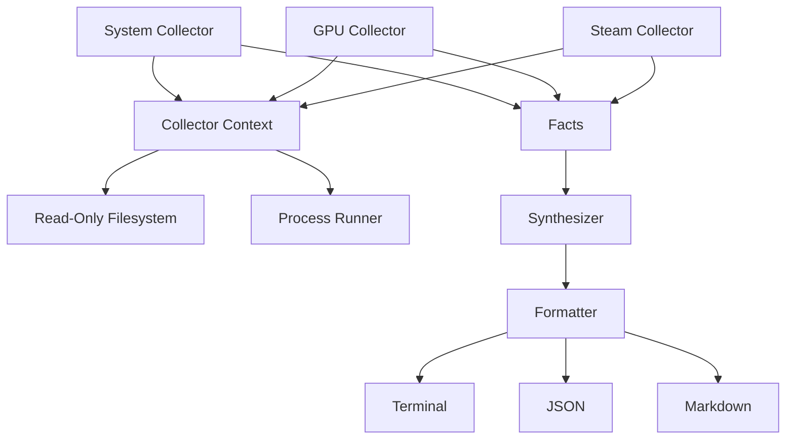

# GameDoc 🩺

[](https://crates.io/crates/gamedoc)
[](https://opensource.org/licenses/MIT)
[](https://github.com/walidbi200/GameDoc/actions/workflows/ci.yml)

GameDoc is a deterministic, read-only Linux gaming diagnostics tool. It inspects your system and generates clean, reproducible reports you can attach to GitHub issues, Reddit posts, Discord discussions, and bug reports.

Think of it as `flutter doctor` or `rustup doctor`, but for Linux gaming.

## What is GameDoc?

When Linux gamers ask for help, the first 10 replies are usually:
- "Are you on X11 or Wayland?"
- "What GPU are you using?"
- "Are you using Flatpak Steam or Native?"
- "Which Proton version?"

GameDoc mechanically answers all of these questions in less than a second. 

## Who is it for?

- **Linux Gamers**: Generate a fast, clean report of your system state to get help faster.
- **Maintainers & Support**: Ask users to run `gamedoc` instead of explaining how to run `lspci`, `glxinfo`, `vulkaninfo`, and digging through directories manually.

## Why is it trustworthy? (The GameDoc Constitution)

GameDoc respects your system. It guarantees the following:
1. **100% Read-Only**: It will **never** mutate your system, write configuration files, or tweak settings.
2. **Privacy First**: It collects absolutely **no telemetry** and makes **no network requests**.
3. **No Shell Execution**: It executes deterministic subprocesses (like `lspci`), but strictly bans arbitrary shell pipelines (`sh -c`).
4. **No Root Required**: GameDoc does not ask for or need `sudo`.
5. **No Speculation**: It reports *facts*, not guesses.

## Architecture

GameDoc relies on an immutable pipeline to ensure robustness and safety:



## How is it different?

GameDoc is **not** a system tweaker, an AI assistant, or a benchmark tool. It does not optimize your kernel or install missing packages. It only provides diagnostics.

## Installation

### Installation Script (Recommended)
You can install the latest pre-built binary using our installation script:

```bash
curl -fsSL https://raw.githubusercontent.com/walidbi200/GameDoc/main/install/install.sh | bash
```

*Note: The script detects your architecture and installs to `/usr/local/bin` (if sudo is available) or `~/.local/bin`.*

### Cargo
```bash
cargo install gamedoc
```

### GitHub Releases
Pre-built binaries for `x86_64` and `aarch64` are available in [GitHub Releases](https://github.com/walidbi200/GameDoc/releases) for Fedora, Ubuntu, Debian, Arch Linux, openSUSE, Bazzite, and SteamOS.

### Build from Source
```bash
git clone https://github.com/walidbi200/GameDoc.git
cd gamedoc
cargo install --path .
```

## Usage and Examples

Run a diagnostic check:
```bash
gamedoc
```

### Example Terminal Output

```text
━━━━━━━━━━━━━━━━━━━━━━━━━━━━━━━━━━━━━━━━━━━━━━━━━━━━━━━━━━━━
 GameDoc 0.1.0  ·  Linux Gaming Diagnostics
━━━━━━━━━━━━━━━━━━━━━━━━━━━━━━━━━━━━━━━━━━━━━━━━━━━━━━━━━━━━

 ── Facts ───────────────────────────────────────────────
    Kernel version         Linux version 6.9.0
    Architecture           x86_64
    Session type           Wayland
    Memory                 16.0 GiB total
    Vendor                 AMD
    Installation           Native (Initialized in ~/.steam/steam)
    Proton                 Native Official: Proton 8.0

 ── Synthesized Problems ────────────────────────────────

   ✗ gpu.vulkan
        vulkaninfo command failed or not found
        → Install vulkan-tools package

━━━━━━━━━━━━━━━━━━━━━━━━━━━━━━━━━━━━━━━━━━━━━━━━━━━━━━━━━━━━
 3 checks  ·  2 ✓ healthy  ·  0 ⚠ warnings  ·  1 ✗ problems 
━━━━━━━━━━━━━━━━━━━━━━━━━━━━━━━━━━━━━━━━━━━━━━━━━━━━━━━━━━━━
```

### Sanitized Sharing

Generate a sanitized report for sharing online (hides your username):
```bash
gamedoc --share
```

### Markdown Report

Generate a Markdown report suitable for a GitHub issue:
```bash
gamedoc --format markdown > report.md
```

<details>
<summary>View Markdown Example</summary>

### System
| Fact | Value |
| --- | --- |
| Kernel version | Linux version 6.9.0 |
| Session type | Wayland |

### Issues
- ❌ **gpu.vulkan**: vulkaninfo command failed or not found
</details>

### JSON Report

Generate a JSON report for external tools:
```bash
gamedoc --format json > report.json
```

```json
{
  "schema": "gamedoc.v1",
  "generator": "gamedoc",
  "version": "0.1.0",
  "facts": [
    {
      "id": "system.session_type",
      "category": "system",
      "value": "Wayland",
      "evidence": {
        "source": "environment_variable",
        "label": "XDG_SESSION_TYPE",
        "trace": null
      }
    }
  ],
  "problems": [],
  "diagnostics": []
}
```

## Supported Platforms

GameDoc officially supports and is tested against:
- **Distributions**: Fedora, Arch Linux, Ubuntu, Debian, openSUSE
- **Gaming OS**: SteamOS, Bazzite
- **Display Servers**: Wayland, X11
- **Hardware**: AMD, NVIDIA, Intel

## Known Limitations

- **Minecraft / Custom Launchers**: Currently lacks heuristics to detect heavily sandboxed custom launchers (e.g., Prism Launcher instances outside default paths).
- **GameMode & MangoHud**: Detection is slated for v0.2.0.

## Project Documentation

* [Architecture (ARCHITECTURE.md)](ARCHITECTURE.md) - Design philosophy and invariants
* [Contributing (CONTRIBUTING.md)](CONTRIBUTING.md) - How to run tests and contribute
* [Roadmap (ROADMAP.md)](ROADMAP.md) - Planned features
* [Security Policy (SECURITY.md)](SECURITY.md) - Reporting vulnerabilities
* [FAQ (FAQ.md)](FAQ.md) - Frequently asked questions

## License

MIT License. See [LICENSE](LICENSE) for details.
