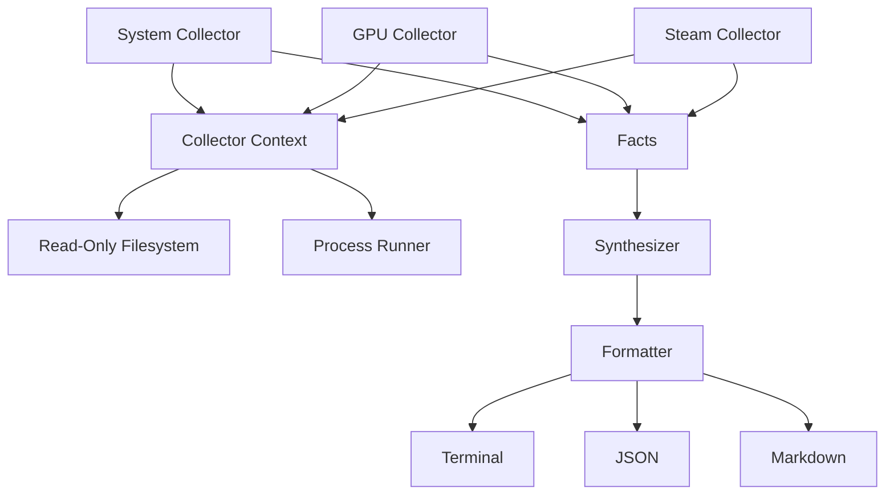

<<<<<<< HEAD
# GameDoc 🩺

[](https://crates.io/crates/gamedoc)
[](https://opensource.org/licenses/MIT)
[](https://github.com/walidbi200/GameDoc/actions/workflows/ci.yml)

GameDoc is a deterministic, read-only Linux gaming diagnostics tool. It inspects your system and generates clean, reproducible reports you can attach to GitHub issues, Reddit posts, Discord discussions, and bug reports.

Think of it as `flutter doctor` or `rustup doctor`, but for Linux gaming.

## What is GameDoc?

When Linux gamers ask for help, the first 10 replies are usually:
- "Are you on X11 or Wayland?"
- "What GPU are you using?"
- "Are you using Flatpak Steam or Native?"
- "Which Proton version?"

GameDoc mechanically answers all of these questions in less than a second. 

## Who is it for?

- **Linux Gamers**: Generate a fast, clean report of your system state to get help faster.
- **Maintainers & Support**: Ask users to run `gamedoc` instead of explaining how to run `lspci`, `glxinfo`, `vulkaninfo`, and digging through directories manually.

## Why is it trustworthy? (The GameDoc Constitution)

GameDoc respects your system. It guarantees the following:
1. **100% Read-Only**: It will **never** mutate your system, write configuration files, or tweak settings.
2. **Privacy First**: It collects absolutely **no telemetry** and makes **no network requests**.
3. **No Shell Execution**: It executes deterministic subprocesses (like `lspci`), but strictly bans arbitrary shell pipelines (`sh -c`).
4. **No Root Required**: GameDoc does not ask for or need `sudo`.
5. **No Speculation**: It reports *facts*, not guesses.

## Architecture

GameDoc relies on an immutable pipeline to ensure robustness and safety:



## How is it different?

GameDoc is **not** a system tweaker, an AI assistant, or a benchmark tool. It does not optimize your kernel or install missing packages. It only provides diagnostics.

## Installation

### Installation Script (Recommended)
You can install the latest pre-built binary using our installation script:

```bash
curl -fsSL https://raw.githubusercontent.com/walidbi200/GameDoc/main/install/install.sh | bash
```

*Note: The script detects your architecture and installs to `/usr/local/bin` (if sudo is available) or `~/.local/bin`.*

### Cargo
```bash
cargo install gamedoc
```

### GitHub Releases
Pre-built binaries for `x86_64` and `aarch64` are available in [GitHub Releases](https://github.com/walidbi200/GameDoc/releases) for Fedora, Ubuntu, Debian, Arch Linux, openSUSE, Bazzite, and SteamOS.

### Build from Source
```bash
git clone https://github.com/walidbi200/GameDoc.git
cd gamedoc
cargo install --path .
```

## Usage and Examples

Run a diagnostic check:
```bash
gamedoc
```

### Example Terminal Output

```text
━━━━━━━━━━━━━━━━━━━━━━━━━━━━━━━━━━━━━━━━━━━━━━━━━━━━━━━━━━━━
 GameDoc 0.1.0  ·  Linux Gaming Diagnostics
━━━━━━━━━━━━━━━━━━━━━━━━━━━━━━━━━━━━━━━━━━━━━━━━━━━━━━━━━━━━

 ── Facts ───────────────────────────────────────────────
    Kernel version         Linux version 6.9.0
    Architecture           x86_64
    Session type           Wayland
    Memory                 16.0 GiB total
    Vendor                 AMD
    Installation           Native (Initialized in ~/.steam/steam)
    Proton                 Native Official: Proton 8.0

 ── Synthesized Problems ────────────────────────────────

   ✗ gpu.vulkan
        vulkaninfo command failed or not found
        → Install vulkan-tools package

━━━━━━━━━━━━━━━━━━━━━━━━━━━━━━━━━━━━━━━━━━━━━━━━━━━━━━━━━━━━
 3 checks  ·  2 ✓ healthy  ·  0 ⚠ warnings  ·  1 ✗ problems 
━━━━━━━━━━━━━━━━━━━━━━━━━━━━━━━━━━━━━━━━━━━━━━━━━━━━━━━━━━━━
```

### Sanitized Sharing

Generate a sanitized report for sharing online (hides your username):
```bash
gamedoc --share
```

### Markdown Report

Generate a Markdown report suitable for a GitHub issue:
```bash
gamedoc --format markdown > report.md
```

<details>
<summary>View Markdown Example</summary>

### System
| Fact | Value |
| --- | --- |
| Kernel version | Linux version 6.9.0 |
| Session type | Wayland |

### Issues
- ❌ **gpu.vulkan**: vulkaninfo command failed or not found
</details>

### JSON Report

Generate a JSON report for external tools:
```bash
gamedoc --format json > report.json
```

```json
{
  "schema": "gamedoc.v1",
  "generator": "gamedoc",
  "version": "0.1.0",
  "facts": [
    {
      "id": "system.session_type",
      "category": "system",
      "value": "Wayland",
      "evidence": {
        "source": "environment_variable",
        "label": "XDG_SESSION_TYPE",
        "trace": null
      }
    }
  ],
  "problems": [],
  "diagnostics": []
}
```

## Supported Platforms

GameDoc officially supports and is tested against:
- **Distributions**: Fedora, Arch Linux, Ubuntu, Debian, openSUSE
- **Gaming OS**: SteamOS, Bazzite
- **Display Servers**: Wayland, X11
- **Hardware**: AMD, NVIDIA, Intel

## Known Limitations

- **Minecraft / Custom Launchers**: Currently lacks heuristics to detect heavily sandboxed custom launchers (e.g., Prism Launcher instances outside default paths).
- **GameMode & MangoHud**: Detection is slated for v0.2.0.

## Project Documentation

* [Architecture (ARCHITECTURE.md)](ARCHITECTURE.md) - Design philosophy and invariants
* [Contributing (CONTRIBUTING.md)](CONTRIBUTING.md) - How to run tests and contribute
* [Roadmap (ROADMAP.md)](ROADMAP.md) - Planned features
* [Security Policy (SECURITY.md)](SECURITY.md) - Reporting vulnerabilities
* [FAQ (FAQ.md)](FAQ.md) - Frequently asked questions

## License

MIT License. See [LICENSE](LICENSE) for details.
=======
# GameDoc

GameDoc is a deterministic, read-only Linux gaming diagnostics tool. It
collects local evidence and produces a standardized report for GitHub issues,
Reddit, Discord, Matrix, forums, and support tickets.

GameDoc does not optimize, benchmark, repair, or configure the system.

> Demo GIF placeholder: `docs/demo.gif` will be added after the first public
> binary release establishes the final terminal capture workflow.

## What It Reports

- Kernel, architecture, desktop session, and CPU governor
- CPU vendor, model, core count, architecture, and virtualization flags
- Distribution name, ID, version, and family (from `/etc/os-release`)
- GPU devices, Vulkan probe status, OpenGL renderer, and OpenGL version
- Native, Flatpak, and Snap Steam installations
- Repeated Steam libraries, Proton runtimes, and custom compatibility tools
- MangoHud executable, config, and environment evidence
- GameMode executable, daemon status, libraries, and config
- Evidence-backed problems and incomplete observations

See [examples/report.txt](examples/report.txt),
[examples/report.md](examples/report.md), and
[examples/report.json](examples/report.json).

## Safety and Privacy

GameDoc is read-only. It never requires root, writes configuration, installs
packages, starts services, launches Steam, invokes a shell, contacts the
network, or sends telemetry.

All output modes pass through privacy finalization before rendering. Reports do
not include usernames, home paths, hostnames, Steam account IDs, environment
variable values, launch arguments, raw stderr, or secrets. `--share` is stricter
and omits collector diagnostics entirely.

Review a report before posting it. Hardware model names, installed tools,
kernel versions, and other diagnostic facts are intentionally included.

## Installation

### Build From Source

GameDoc v0.1.0 requires Rust 1.74 or newer.

```bash
# From a GameDoc source checkout:
cargo build --release
./target/release/gamedoc --share
```

GameDoc is not yet distributed through a package manager.

## Usage

```text
gamedoc                        terminal report with privacy-safe diagnostics
gamedoc --share                terminal report without collector diagnostics
gamedoc --no-color             terminal report without ANSI colour
gamedoc --format markdown      GitHub-flavored Markdown
gamedoc --format json          stable gamedoc.v1 JSON
gamedoc --share --format json  shareable JSON
gamedoc completions bash       print Bash completion script
gamedoc completions zsh        print Zsh completion script
gamedoc completions fish       print Fish completion script
gamedoc man                    print the man page in roff format
gamedoc --version
gamedoc --help
```

Colour output is suppressed automatically when the `NO_COLOR` environment
variable is set, or explicitly with `--no-color`.

GameDoc writes reports to standard output and does not create files. Redirect
output only when you explicitly want a file:

```bash
gamedoc --format markdown > report.md
gamedoc --format json > report.json
```

## JSON Contract

The public schema is `gamedoc.v1`:

```json
{
  "schema": "gamedoc.v1",
  "gamedoc_version": "0.1.0",
  "facts": [],
  "problems": [],
  "checks": []
}
```

Within v1, changes are additive. Existing fields and stable IDs are not renamed
or removed. Consumers should ignore unknown fields.

## Limitations

- Vulkan execution evidence depends on `vulkaninfo` being installed.
- OpenGL evidence depends on `glxinfo` and a usable display session.
- Steam library parsing supports the quoted `path` entries used by current
  `libraryfolders.vdf` files; malformed metadata is treated as incomplete.
- GameMode daemon status depends on `gamemoded -s` being available.
- Absence of evidence is not treated as proof that software is absent.
- GameDoc currently targets Linux only.

## Performance

GameDoc runs in parallel across all collectors. Median execution time on modern hardware is under **0.7 seconds**. Runs may occasionally stretch to ~2.7 seconds if a collector times out (e.g., missing daemons or unreadable configurations gracefully timing out at the 2.5s limit). See [BENCHMARKS.md](BENCHMARKS.md).

## What GameDoc does not do (yet)

- Optimize game performance
- Automatically apply recommended fixes
- Upload reports automatically

## Supply Chain

GameDoc binaries are built using reproducible builds on GitHub Actions, audited with `cargo-audit`, dependencies validated with `cargo-deny`, and release artifacts signed using keyless sigstore (`cosign`). An SBOM (CycloneDX) is provided with every release.

## Development

The architecture is governed by [ARCHITECTURE.md](ARCHITECTURE.md). Read it
before changing collection, facts, rules, synthesis, reports, or rendering.

```bash
cargo fmt --check
cargo clippy --all-targets --all-features -- -D warnings
cargo test --all-targets --all-features
cargo test --doc
cargo build --release
```

See [CONTRIBUTING.md](CONTRIBUTING.md) for fixture and golden-test workflows.

## Project Documents

- [Architecture](ARCHITECTURE.md)
- [Contributing](CONTRIBUTING.md)
- [Security and privacy](SECURITY.md)
- [FAQ](FAQ.md)
- [Roadmap](ROADMAP.md)
- [Changelog](CHANGELOG.md)
- [Release checklist](RELEASE.md)

## License

GameDoc is available under the [MIT License](LICENSE).
>>>>>>> 2109919 (v0.2.0)
